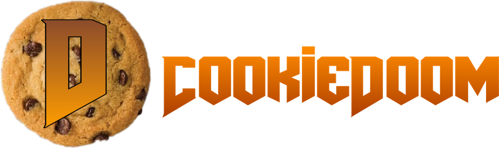
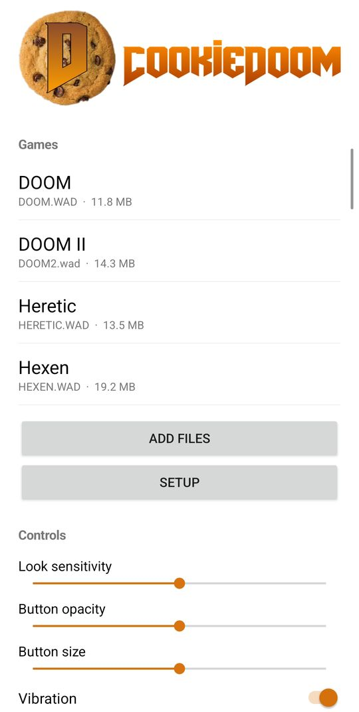
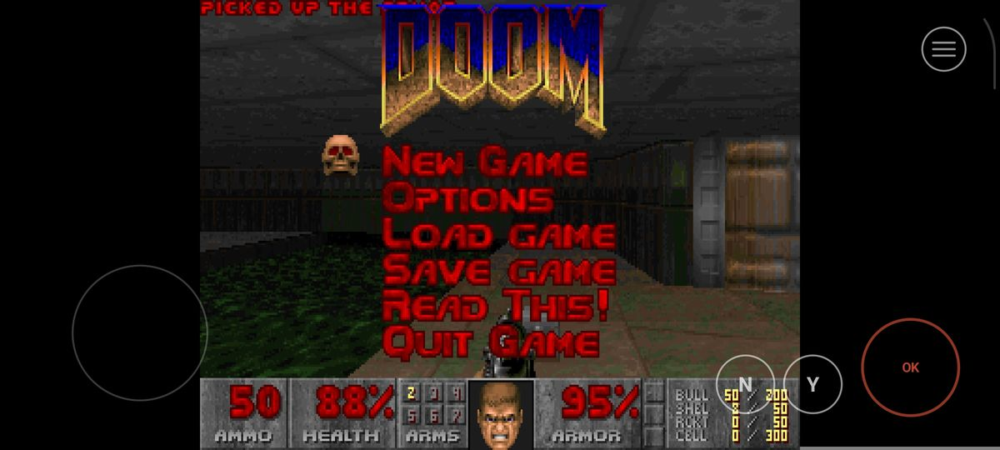
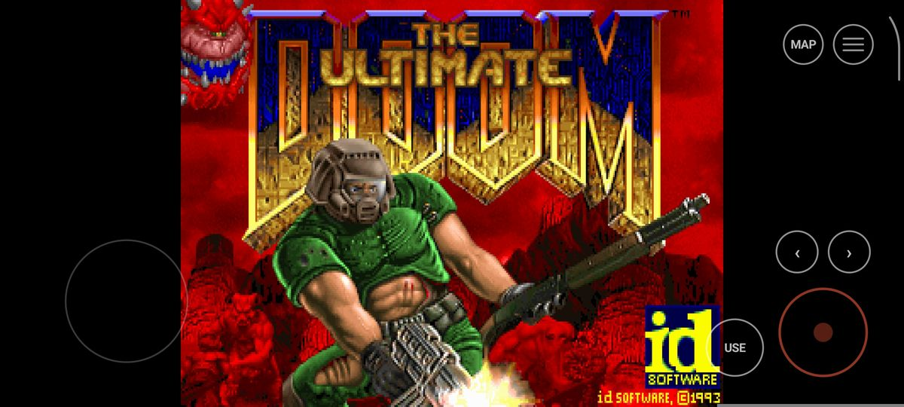
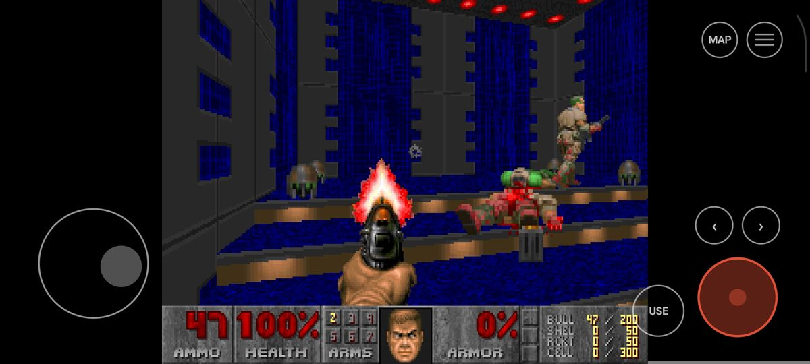

# CookieDoom

<p align="center"></p>

An Android port of [Chocolate Doom](https://www.chocolate-doom.org/) 3.1.1, the
vanilla-faithful source port of Doom, Heretic, Hexen and Strife. It keeps the
original gameplay and adds a touch interface and a simple launcher.

## Screenshots

| Launcher | Game menu |
|---|---|
|  |  |

| Title screen | Gameplay |
|---|---|
|  |  |

## Features

- Doom, Doom II, Final Doom, Heretic, Hexen and Strife in one app
- Simple launcher: add your WAD files, tap a game to play
- PWAD and DeHackEd mods, switched on and off with a checkbox
- On-screen controls with a movement stick, touch look, weapon switching and
  adjustable sensitivity, size and opacity
- Menu navigation with touch, and the Android keyboard for naming save games
- Original Chocolate Doom Setup built in (video, sound, keyboard, mouse and
  gamepad settings, plus the multiplayer lobby)
- Multiplayer over a local network or a VPN (experimental)
- Authentic OPL music emulation, as in the desktop version

## Game data

The app does not include any game data. You need your own copy of the game
files, for example `doom.wad`, `doom2.wad`, `heretic.wad`, `hexen.wad` or
`strife1.wad`. The free [Freedoom](https://freedoom.github.io/) works too.

Open the app, tap **Add files** and pick your WAD files.

## Building

Requirements: Android Studio, JDK 17, Android SDK 36 and NDK 29.

```
git clone https://github.com/CanavarIT/CookieDoom.git
cd CookieDoom
./gradlew assembleDebug
```

The first build downloads SDL2, SDL2_mixer and SDL2_net automatically
(`./gradlew fetchDeps`), so they are not stored in this repository.

Supported ABIs: `arm64-v8a` and `armeabi-v7a`. Minimum Android version: 8.0
(API 26).

## Project layout

- `app/src/main/java/com/cookie/doom/` - launcher, game and Setup activities,
  touch controls
- `app/src/main/cpp/` - CMake build, the JNI bridge and the Chocolate Doom
  sources
- `app/src/main/cpp/chocolate-doom/` - Chocolate Doom engine (with small Android
  changes)

## License and credits

CookieDoom is free software, released under the GNU General Public License,
version 2, like Chocolate Doom. See [LICENSE](LICENSE).

- [Chocolate Doom](https://github.com/chocolate-doom/chocolate-doom) by Simon
  Howard and contributors
- [SDL2](https://www.libsdl.org/), SDL2_mixer and SDL2_net
- Doom, Heretic, Hexen and Strife are trademarks of their respective owners.
  This project is not affiliated with id Software, Raven Software or
  Rogue Entertainment.
